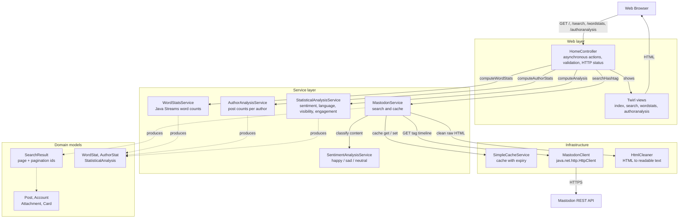

# MAWA: Mastodon Analysis Web App (Delivery 1)

**SOEN 6441 - Advanced Software Architecture & Programming Practices**

This is an asynchronous **Play Framework (Java)** web application. It monitors and analyzes posts for a Mastodon hashtag. The pages are HTML built on the server with Bootstrap CSS. Chart.js is used only for the statistical summary charts. The app uses plain HTTP requests and responses. It does not use WebSockets, actors or reactive streams.

**Team / @author:** Kush Chaudhari, Mihir Vipulbhai Panchal, Owen Van Esbroeck, Qiang Xue

---

## Contents

1. [Prerequisites & Installation](#1-prerequisites--installation)
2. [Configuration](#2-configuration)
3. [Running the Application](#3-running-the-application)
4. [How to Use the Application](#4-how-to-use-the-application)
5. [Project Structure](#5-project-structure)
6. [Routes](#6-routes)
7. [Tests, Coverage & Javadoc](#7-tests-coverage--javadoc)
8. [Architecture & Design Document](#8-architecture--design-document)
9. [Assumptions & Limitations](#9-assumptions--limitations)

---

## Documentation

The group part and each individual feature have a dedicated document:

| Document | Scope | Author(s) |
| :--- | :--- | :--- |
| [Group Part](docs/group.md) | Play application, hashtag search, post display, pagination, error handling, caching and shared architecture | Kush Chaudhari, Mihir Vipulbhai Panchal, Owen Van Esbroeck, Qiang Xue |
| [Author Analysis](docs/author-analysis.md) | Per-page author contributions, ranking and language breakdown | Kush Chaudhari |
| [Sentiment Analysis](docs/sentiment-analysis.md) | Happy/sad/neutral classification, word and emoji lists, 70% rule | Mihir Vipulbhai Panchal |
| [Statistical Analysis](docs/statistical-analysis.md) | Sentiment/language/visibility counts and engagement metrics | Owen Van Esbroeck |
| [Word Statistics](docs/word-stats.md) | Unique-word frequency table and Streams pipeline | Qiang Xue |

UI ownership is recorded in the documents and in the view/CSS headers: **Qiang Xue** owns the basic HTML layout, Bootstrap integration, pagination and base stylesheet. **Owen Van Esbroeck** owns the post card, avatar, attachment and link preview display.

---

## Generative AI Usage Disclosure

We used generative AI coding agents, such as Google Antigravity and Claude Code. We used them in four ways:

1. To set up the project structure.
2. To help find bugs and troubleshoot environment setup problems.
3. To draft code comments and document outlines.
4. To improve the wording of text we had written.

We wrote the application code by hand. For the documents, we wrote the content first and then used a large language model (LLM) to refine the wording. We wrote the prompts for each problem we met during the project. We did not use a fixed prompt template.

---

## 1. Prerequisites & Installation

| Requirement | Version |
| :--- | :--- |
| Java Development Kit (JDK) | **OpenJDK 25** |
| Build tool | **sbt 1.10.2** (pinned in `project/build.properties`) |
| Play Framework | 3.0.11 (`org.playframework` sbt plugin) |
| Browser | Any modern browser |

### Clone & Setup
```bash
git clone <repository-url>
cd SOEN6441GroupProject
```

> **Use JDK 25 for `sbt test` / `sbt jacoco` / `sbt javadoc`.** The build uses `sbt-jacoco` 3.7.0, which instruments class files produced by JDK 25 correctly.

---

## 2. Configuration

MAWA reads its configuration from environment variables, so no credential is ever committed to the repository. All values are bound in [`conf/application.conf`](conf/application.conf).

### Environment Variables

| Variable | Description | Default |
| :--- | :--- | :--- |
| `MASTODON_INSTANCE` | Domain of the Mastodon instance to query | `mastodon.social` |
| `MASTODON_ACCESS_TOKEN` | User access token with `read:statuses` scope | *(empty: public timelines still work)* |
| `MASTODON_PAGE_SIZE` | Posts requested per result page (1 to 40; larger values are capped at 40) | `40` in the checked-in `application.conf`; code fallback `5` when missing/invalid |

### Example Setup (Linux / macOS)
```bash
export MASTODON_INSTANCE="mastodon.social"
export MASTODON_ACCESS_TOKEN="your_access_token_here"
export MASTODON_PAGE_SIZE="20"
```

### Configuration File
```hocon
mastodon {
  instance = "mastodon.social"
  instance = ${?MASTODON_INSTANCE}
  token = ""
  token = ${?MASTODON_ACCESS_TOKEN}

  # Posts fetched per page; the Mastodon API returns at most 40 statuses per request.
  pageSize = 40
  pageSize = ${?MASTODON_PAGE_SIZE}
}
```

`mastodon.pageSize` is checked once at startup (`MastodonServiceImpl#readPageSize`). The checked-in `conf/application.conf` uses `40`, so a fresh run requests up to 40 posts per page. The code fallback of `5` applies only when the key is absent or invalid:

| Configured value | Effective page size |
| :--- | :--- |
| missing, or not a number | `5` (code fallback) |
| `0` or negative | `5` (code fallback) |
| `1` ... `40` | the configured value |
| greater than `40` | `40` (Mastodon API maximum) |

The page size is used both as the API `limit` parameter **and** as the threshold that decides whether a result page is full and therefore has a "Next" page.

---

## 3. Running the Application

```bash
PATH="/usr/lib/jvm/java-25-openjdk-amd64/bin:$PATH" \
JAVA_HOME=/usr/lib/jvm/java-25-openjdk-amd64 sbt run
```

Then open <http://localhost:9000>.

Equivalent with environment configuration:
```bash
MASTODON_INSTANCE=mastodon.social MASTODON_PAGE_SIZE=10 sbt run
```

---

## 4. How to Use the Application

### 4.1 Hashtag Search (group feature)
1. **Search input:** on the home page enter a hashtag (e.g. `java`, `technology`, `montreal`) and press **Search**. A leading `#` is optional and stripped. A Mastodon hashtag consists of **letters, digits and underscores**; anything else (`c#`, `hello world`, `java/lang`, ...) is rejected with `400 Bad Request` and a clear message, so it never reaches the API.
2. **Results:** the app calls `GET /api/v1/timelines/tag/{hashtag}` and shows up to `mastodon.pageSize` posts (checked-in default 40; code fallback 5; API maximum 40) with:
   - **Author:** display name, `@username` and avatar.
   - **Publication date/time:** ISO timestamp as returned by the API.
   - **Language:** ISO code (e.g. `EN`, `FR`).
   - **Visibility:** `public`, `unlisted` and others.
   - **Clean content:** the raw HTML returned by Mastodon is converted to readable plain text (`HtmlCleaner`) and is never shown as markup.
   - **Original link:** a direct link to the post on its Mastodon instance.
   - **Statistical summary:** a short summary of the page's posts.
3. **Pagination:** the page shows Previous, Page N and Next controls below the feed.
   - `Next` calls `GET /search?hashtag=...&max_id=<last post id>&page=N+1` (Mastodon `max_id`, older posts).
   - `Previous` calls `GET /search?hashtag=...&min_id=<first post id>&page=N-1` (Mastodon `min_id`, newer posts).
   - each page has its own GET URL that can be saved as a bookmark. `Next` appears only when a page is full.
4. **Caching:** each page is cached for 5 minutes with the key `tag:<hashtag>:max_id:<id|latest>:min_id:<id|latest>:page:<n>`, so returning to a page (or opening its word statistics) never triggers a second Mastodon request.
5. **URL safety:** the hashtag and the pagination ids are encoded for the URL before the REST call, so characters that have a special meaning in a URL (e.g. `#`, accented letters) cannot break the request. Without this, `c#` would produce `.../timelines/tag/c#?limit=...`, where everything after `#` becomes a URL fragment: the `limit` parameter is dropped and Mastodon falls back to its own default of **20** statuses per request.

### 4.2 Word-Level Statistics (individual feature: Task 5)
1. **Accessing statistics:** the search-term header (`#java`), the *View word statistics* link and the **Word Stats** button are plain GET links. They carry the current page (`/wordstats?hashtag=java&max_id=...&page=2`), so the statistics always describe the posts the user is actually looking at.
2. **Analysis breakdown:**
   - **Total words counted:** the total number of words on the page's posts.
   - **Unique words:** the number of different words.
   - **Frequency table:** every unique word, from highest to lowest count. If counts are equal, the words are sorted alphabetically. The table shows rank, count and a percentage bar.
3. **Implementation notes:**
   - The counts are computed with the **Java Streams API** (`filter`, `map`, `flatMap`, `groupingBy`, `counting`, `sorted`, `collect`). See [`WordStatsServiceImpl.java`](app/services/WordStatsServiceImpl.java).
   - The statistics link reuses the page's `max_id` / `min_id` / `page`, so the service answers from the cache and makes no extra Mastodon call.
   - The page has no POST form, no form protection token and no JavaScript.

### 4.3 Author Analysis
1. **Accessing analysis:** use the **Analyze Authors on This Page** button on a search result page. The current page and its pagination ids are carried to the analysis, so it describes only the posts shown on that page.
2. **Contribution breakdown:** authors are ranked by their post count and page share. Each row shows the author's profile details, latest post and its link, and the language counts for that author's posts on the page.
3. **Caching:** author analysis reuses the same page-based search cache as the results page, avoiding an additional Mastodon request when that page is already cached.

### 4.4 Sentiment and Statistical Analysis (individual features)
1. **Sentiment:** every result card shows a `:-)`, `:-(` or `:-|` badge computed by `SentimentAnalysisService`: see [Sentiment Analysis](docs/sentiment-analysis.md) (Mihir Vipulbhai Panchal).
2. **Statistics:** the top of the results page shows the page's sentiment, language, visibility and engagement summaries: see [Statistical Analysis](docs/statistical-analysis.md) (Owen Van Esbroeck).

---

## 5. Project Structure

```
SOEN6441GroupProject/
├── app/
│   ├── controllers/
│   │   └── HomeController.java        # single asynchronous controller (index, search, wordStats, authorAnalysis)
│   ├── models/
│   │   ├── Account.java               # post author
│   │   ├── Attachment.java            # image/video attachment
│   │   ├── AuthorStat.java            # author activity for one search-result page
│   │   ├── Card.java                  # link preview card
│   │   ├── Post.java                  # status model, not tied to REST (plain + raw content)
│   │   ├── SearchResult.java          # one result page + pagination ids (read-only)
│   │   ├── StatisticalAnalysis.java   # statistical summaries + JSON helpers
│   │   └── WordStat.java              # unique word + frequency
│   ├── services/
│   │   ├── AuthorAnalysisService.java / Impl.java    # author statistics
│   │   ├── HtmlCleaner.java                          # HTML to readable text
│   │   ├── MastodonClient.java / Impl.java           # java.net.http REST client
│   │   ├── MastodonService.java / Impl.java          # cache, parsing, page size
│   │   ├── SentimentAnalysisService.java / Impl.java # happy/sad/neutral classifier
│   │   ├── SimpleCacheService.java                   # cache with expiry
│   │   ├── StatisticalAnalysisService.java / Impl.java # summary statistics
│   │   └── WordStatsService.java / Impl.java         # Java Streams word frequency
│   ├── views/
│   │   ├── main.scala.html            # basic layout (Bootstrap CSS CDN + stylesheet): Qiang Xue
│   │   ├── index.scala.html           # home / search form: Qiang Xue
│   │   ├── search.scala.html          # results, stats, pagination, post cards: Qiang Xue / Owen Van Esbroeck
│   │   ├── wordstats.scala.html       # word statistics page: Qiang Xue
│   │   ├── authoranalysis.scala.html  # author contribution page: Kush Chaudhari
│   │   ├── authors.scala.html         # legacy top-authors view: Kush Chaudhari
│   │   └── stats.scala.html           # legacy word-statistics view: Qiang Xue
│   └── Module.java                    # Guice bindings (interfaces to implementations)
├── conf/
│   ├── application.conf               # Mastodon instance / token / page size
│   ├── routes                         # URL to controller mapping
│   └── logback.xml                    # logging
├── docs/                              # group and individual feature documents
│   ├── group.md
│   ├── author-analysis.md
│   ├── sentiment-analysis.md
│   ├── statistical-analysis.md
│   └── word-stats.md
├── public/
│   ├── images/favicon.png
│   ├── javascripts/chart.js           # statistical chart drawing: Owen Van Esbroeck
│   └── stylesheets/main.css           # base styles Qiang Xue, post/attachment cards Owen Van Esbroeck
├── test/                              # JUnit 4 + Mockito unit tests (no network calls)
│   ├── controllers/HomeControllerTest.java
│   ├── models/{Account,Attachment,Card,Post,SearchResult,StatisticalAnalysis,WordStat}Test.java
│   └── services/{AuthorAnalysisServiceImpl,HtmlCleaner,MastodonClientImpl,MastodonServiceImpl,
│                 SentimentAnalysisServiceImpl,SimpleCacheService,StatisticalAnalysisServiceImpl,
│                 WordStatsServiceImpl}Test.java
├── build.sbt                          # Play project, Guice, Mockito, JaCoCo excludes, javadoc task
├── project/{build.properties,plugins.sbt}
└── README.md
```

---

## 6. Routes

All routes are defined in [`conf/routes`](conf/routes). Every page uses a `GET` request that can be saved as a bookmark. Delivery 1 has no POST forms, form protection tokens, WebSocket routes or streaming routes.

### 6.1 Route table

| Method | Path | Action | Purpose |
| :--- | :--- | :--- | :--- |
| `GET` | `/` | `HomeController.index()` | Home page with the hashtag search form |
| `GET` | `/search` | `HomeController.search(hashtag, max_id, min_id, page)` | One page of search results |
| `GET` | `/wordstats` | `HomeController.wordStats(hashtag, max_id, min_id, page)` | Word statistics for one result page |
| `GET` | `/authoranalysis` | `HomeController.authorAnalysis(hashtag, max_id, min_id, page)` | Author contributions for one result page |
| `GET` | `/assets/*file` | `Assets.versioned(path="/public", file)` | Static resources from `public/` |

### 6.2 Query parameters

`/search`, `/wordstats` and `/authoranalysis` share the same parameter set:

| Parameter | Required | Default | Meaning |
| :--- | :--- | :--- | :--- |
| `hashtag` | yes | none | Hashtag with or without the leading `#`; must match `[\p{L}\p{Nd}_]+` |
| `max_id` | no | latest | Mastodon pagination id for the next (older) page |
| `min_id` | no | latest | Mastodon pagination id for the previous (newer) page |
| `page` | no | `1` | 1-based display/bookkeeping page number; values below 1 are treated as page 1 |

The word statistics and author analysis actions pass the search page's pagination ids to `MastodonService.searchHashtag`. They reuse the cached `SearchResult` and do not make another Mastodon request.

### 6.3 Example URLs

```text
/                                          # home page
/search?hashtag=java                      # first page
/search?hashtag=java&max_id=110&page=2    # next (older) page
/search?hashtag=java&min_id=130&page=1    # previous (newer) page
/wordstats?hashtag=java&max_id=110&page=2
/authoranalysis?hashtag=java&min_id=130&page=1
```

### 6.4 Response status

| Status | When |
| :--- | :--- |
| `200 OK` | Valid request, including an empty result page |
| `400 Bad Request` | Empty/invalid hashtag, or a `page` value that Play cannot parse as an integer |
| `500 Internal Server Error` | Mastodon unavailable, non-200 API response, timeout or unreadable API response |

Every action returns `CompletionStage<Result>` and a human-readable Twirl view. Raw exceptions and stack traces are never sent to the browser.

---

## 7. Tests, Coverage & Javadoc

MAWA is tested with **JUnit 4**, **Mockito** and **JaCoCo** (118 tests). Unit tests never touch the live Mastodon API: `MastodonClient`, `SimpleCacheService` and the analysis services are mocked or tested in isolation.

### Test suites

| Area | Test class | Focus |
| :--- | :--- | :--- |
| Controller | `HomeControllerTest` | `index`, `search`, `wordStats` and `authorAnalysis` actions; status codes; validation; pagination links and page normalization; sentiment display; author-analysis empty state and HTML escaping |
| Model | `AccountTest` | Construction, defaults for null values, equality and `toString` |
| Model | `AttachmentTest` | Construction, media-type checks, `videoType`, equality |
| Model | `CardTest` | Construction, equality and `toString` |
| Model | `PostTest` | Constructors, equality, engagement fields, card presence and `toString` |
| Model | `SearchResultTest` | Success/error construction and `max_id`/`min_id` pagination ids |
| Model | `StatisticalAnalysisTest` | Getters, sentiment keys and JSON helper methods |
| Model | `WordStatTest` | Construction, equality and null handling |
| Service | `AuthorAnalysisServiceImplTest` | Author id/username/URL grouping (including case-insensitive username fallback and distinct account IDs), language counts, latest post, count/display-name/username sorting, immutable results and null/empty input |
| Service | `HtmlCleanerTest` | Tag stripping, named/numeric entities and whitespace cleanup |
| Service | `MastodonClientImplTest` | Request URL building, Authorization header, URL encoding and HTTP errors |
| Service | `MastodonServiceImplTest` | Cache hits and misses, JSON parsing, sentiment integration, page size checks and error messages |
| Service | `SentimentAnalysisServiceImplTest` | Happy/sad/neutral classification, negation, emojis and the 70% boundary |
| Service | `SimpleCacheServiceTest` | Get/set, expiry, null keys/values and `clear` |
| Service | `StatisticalAnalysisServiceImplTest` | Sentiment, language, visibility and engagement values |
| Service | `WordStatsServiceImplTest` | Word splitting, punctuation and case, ordering, Unicode and digits |

`jacocoExcludes` in [`build.sbt`](build.sbt) removes Twirl-generated views, the router and `Module` from the report. All controller, model, service and analysis branches are covered.

### Run unit tests
```bash
PATH="/usr/lib/jvm/java-25-openjdk-amd64/bin:$PATH" \
JAVA_HOME=/usr/lib/jvm/java-25-openjdk-amd64 sbt test
```

Run one test class or one test method:
```bash
sbt "testOnly controllers.HomeControllerTest"
sbt "testOnly services.MastodonServiceImplTest -- --tests=testSearchHashtagWithEmptyOrNullInput"
```

### Run JaCoCo coverage
```bash
PATH="/usr/lib/jvm/java-25-openjdk-amd64/bin:$PATH" \
JAVA_HOME=/usr/lib/jvm/java-25-openjdk-amd64 sbt jacoco
```
```
Lines:        100% (0 of 508 missed)
Instructions: 100% (0 of 3561 missed)
Branches:     100% (0 of 322 missed)
Methods:      100% (0 of 73 missed)
Complexity:   100% (0 of 234 missed)
Class:        100% (0 of 19 missed)
```
HTML report: `target/scala-2.13/jacoco/report/html/index.html`

### Generate Javadoc (application, tests and private members)
```bash
PATH="/usr/lib/jvm/java-25-openjdk-amd64/bin:$PATH" \
JAVA_HOME=/usr/lib/jvm/java-25-openjdk-amd64 sbt javadoc
```
The `javadoc` task (defined in [`build.sbt`](build.sbt)) runs the JDK's `javadoc` tool over `app/` **and** `test/` with `-private`, so private methods and unit tests are documented too.
```bash
sbt doc       # alternative: scaladoc/API browser for the public API
```
| Command | Output |
| :--- | :--- |
| `sbt javadoc` | `target/javadoc/index.html` (private members + tests included) |
| `sbt doc` | `target/scala-2.13/api/index.html` (public API browser) |

### Other standard targets
```bash
sbt compile    # build
sbt clean      # remove build output
```

---

## 8. Architecture & Design Document

### 8.1 Architecture Diagram



### 8.2 Domain Model

All domain classes are independent of the data source. They do not know about JSON, HTTP or Mastodon annotations, so Delivery 2 can reuse them unchanged.

1. **`Account`** (`app/models/Account.java`) holds the post author fields: `id`, `username`, `displayName`, `url` and `avatar`. It handles null values and checks equality by value.
2. **`Attachment`** (`app/models/Attachment.java`) holds an image or video attachment: `id`, `type`, `url`, `previewUrl`, `description`, `width` and `height`. It also has media type helpers.
3. **`Card`** (`app/models/Card.java`) holds a link preview card: `url`, `title`, `description`, `type`, `width`, `height` and `image`.
4. **`Post`** (`app/models/Post.java`) holds a read-only status: `id`, `author`, `createdAt`, `language`, `content` (clean text), `rawContent` (original HTML), `url`, `visibility`, `sentiment`, reply/reblog/favourite counts, `attachments` and `card`.
5. **`SearchResult`** (`app/models/SearchResult.java`) holds **one page** of results: the posts, the 1-based `page`, the `pageMaxId` / `pageMinId` used for the request, the `nextMaxId` / `prevMinId` pagination ids (`hasNext()` / `hasPrevious()`) and an optional error message.
6. **`WordStat`** (`app/models/WordStat.java`) holds a unique word and its frequency for the word statistics feature.
7. **`AuthorStat`** (`app/models/AuthorStat.java`) holds one author's post count, latest post and language counts for the analysed page.
8. **`StatisticalAnalysis`** (`app/models/StatisticalAnalysis.java`) holds read-only sentiment, language and visibility counts, engagement values and JSON helpers for the summary charts.

### 8.3 Component Responsibilities

| Component | Responsibility |
| :--- | :--- |
| `HomeController` | Single controller. Validates input, cleans the hashtag, delegates to the requested analysis service, chooses the HTTP status and view. Returns `CompletionStage<Result>` for every action. |
| `MastodonService` / `Impl` | Cache lookup/store, calling the client for the requested page, parsing JSON into `Post`/`Account`/`Attachment`/`Card`, assigning sentiment, translating failures into `SearchResult` errors, and reading `mastodon.pageSize` (validated and capped). |
| `MastodonClient` / `Impl` | Builds the REST URL (`limit`, `max_id`, `min_id`) and encodes the hashtag and ids for the URL. It sends the `Authorization` header only when a token is configured and turns non-200 responses into errors. |
| `SimpleCacheService` | In-memory cache built on `ConcurrentHashMap`. It is safe to use from multiple threads. Each entry expires after five minutes. The search and analysis pages share it. |
| `WordStatsService` / `Impl` | Splits post text into words with a Unicode-aware regex, counts unique words and sorts them from high to low count. Pure Java Streams. |
| `AuthorAnalysisService` / `Impl` | Groups the page's posts by author id/username/URL, counts posts, counts languages, keeps the latest post and ranks authors. |
| `SentimentAnalysisService` / `Impl` | Classifies each post's clean content as happy, sad or neutral using word/emoji lists, negation and the 70% threshold. Called from `MastodonServiceImpl.parsePosts`. |
| `StatisticalAnalysisService` / `Impl` | Counts and calculates sentiment, language, visibility and engagement values with Java Streams. The results fill the summary charts. |
| `HtmlCleaner` | Converts Mastodon HTML into readable plain text: removes tags, decodes named/numeric entities, collapses extra spaces. |
| `Module` | Guice bindings for `MastodonClient`, `MastodonService`, `SentimentAnalysisService`, `AuthorAnalysisService`, `StatisticalAnalysisService` and `WordStatsService`. |
| Twirl views | Show the home, search, word statistics and author analysis pages. The controller and services prepare all analysis data. |

### 8.4 How Mastodon Is Isolated

- Domain models (`Post`, `Account`, `Attachment`, `Card`, `SearchResult`, `WordStat`, `AuthorStat`, `StatisticalAnalysis`) contain no JSON parsing, no HTTP and no Mastodon annotations.
- All REST details live in `MastodonClientImpl` (URL and query string building, Authorization header) and in the parsing code of `MastodonServiceImpl#parsePosts`.
- Everything else depends on interfaces (`MastodonService`, `MastodonClient`, `WordStatsService`, `AuthorAnalysisService`, `SentimentAnalysisService`, `StatisticalAnalysisService`). This lets tests replace every dependency with a Mockito mock.
- The `Post` model is independent of how the post was obtained. This is the Delivery 2 requirement for the streaming API.

### 8.5 Where and Why Java Streams Are Used

Java Streams drive the three individual tasks that explicitly require them.

#### 8.5.1 Word statistics: [`WordStatsServiceImpl`](app/services/WordStatsServiceImpl.java)

```java
posts.stream()
    .filter(post -> post != null && post.getContent() != null && !post.getContent().trim().isEmpty())
    .map(Post::getContent)
    .flatMap(content -> Arrays.stream(WORD_DELIMITER_PATTERN.split(content.toLowerCase())))
    .map(String::trim)
    .filter(word -> !word.isEmpty())
    .collect(Collectors.groupingBy(Function.identity(), Collectors.counting()))
    .entrySet()
    .stream()
    .sorted(Map.Entry.<String, Long>comparingByValue().reversed()
            .thenComparing(Map.Entry.comparingByKey()))
    .map(entry -> new WordStat(entry.getKey(), entry.getValue()))
    .collect(Collectors.toList());
```

- **`filter` / `map`:** keep only non-blank posts and extract their text.
- **`flatMap`:** turn many posts into one stream of words. The split pattern `[^\p{L}\p{Nd}]+` keeps accented letters and digits.
- **`groupingBy` + `counting`:** build the frequency table in one pass, with no manual map updates.
- **`sorted`:** put the highest count first, then use alphabetical order when counts are equal. This keeps the order stable.
- **`collect`:** build the read-only `List<WordStat>` that the view receives.

#### 8.5.2 Sentiment analysis: [`SentimentAnalysisServiceImpl`](app/services/SentimentAnalysisServiceImpl.java)

- `TOKEN_PATTERN.matcher(normalized).results().map(...).toArray(...)` splits text into words and clause punctuation without writing a loop.
- `IntStream.range(0, words.length).filter(...).count()` counts happy and sad words, including the three-word negation window.
- `symbols.stream().mapToLong(symbol -> countOccurrences(content, symbol)).sum()` counts each emoticon and emoji in the happy and sad symbol lists.

#### 8.5.3 Statistical analysis: [`StatisticalAnalysisServiceImpl`](app/services/StatisticalAnalysisServiceImpl.java)

- `posts.stream().collect(Collectors.groupingBy(..., Collectors.counting()))` builds the sentiment, language and visibility count maps.
- `posts.stream().map(Post::getRepliesCount).map(Double::valueOf).toList()` collects the engagement values. `values.stream().reduce(...)` calculates the sum, minimum and maximum. The average is `sum / size`.

### 8.6 Evolution Toward Delivery 2

- Delivery 2 adds **Apache Pekko actors**, **Play WebSockets** and the **Mastodon Streaming API**.
- `Post` and `Account` are independent of the data source. The actor pipeline can build `Post` objects from streamed statuses and pass them to the same analysis code.
- `WordStatsService` already accepts a `List<Post>`, so streamed batches can be analysed without changing the analysis code.
- The cache and service interfaces make it easy to add a streaming source. The controller and views do not need to know where posts come from.

---

## 9. Assumptions & Limitations

- **Delivery 1 scope:** plain HTTP request and response only. There are no WebSockets, Pekko actors, streaming API or reactive pipelines in this delivery.
- **Analysis scope:** the word, author, sentiment and statistical results describe the **current result page**, not the entire hashtag history. The word and author pages intentionally reuse the page's `max_id` / `min_id` / `page` so they can answer from the search cache.
- **Pagination model:** `Next` uses `max_id` (older posts) and `Previous` uses `min_id` (newer posts). Returning to a previous page rebuilds it from the current page's first post id. This assumes pages of the configured size. If a post is deleted between requests, the page contents can shift a little.
- **Page size:** the checked-in `application.conf` requests 40 posts per page. The code fallback is 5 when the key is missing or invalid. The Mastodon API returns at most 40 posts per request, so larger values are capped.
- **Caching:** search results stay in the cache for five minutes. A new post may not appear until the cache entry expires or the user requests a page with a different id.
- **Sentiment:** classification is rule-based and uses lists of English and Portuguese words plus emoticons and emojis. It does not understand sarcasm or context and does not cover other languages. At least two matches are required, and the winning side must be over 70%.
- **Charts:** the statistical summary uses Chart.js from a CDN and the local `public/javascripts/chart.js`. If the CDN cannot be reached, the charts do not appear, but the post text is still available.
- **Language filtering:** the Mastodon REST API has no server-side language filter for hashtag timelines. The page shows each post's `language` value as the API returns it.
- **Rate limits:** public instances rate-limit unauthenticated traffic. Configuring `MASTODON_ACCESS_TOKEN` is recommended for frequent searches and demos.
- **Coverage tooling:** `sbt-jacoco` 3.7.0 instruments JDK 25 classes; `sbt jacoco` reports 100% line, branch, method, complexity and class coverage for all included production classes.
# MAWA-Mastodon-Analysis-Web-App-

