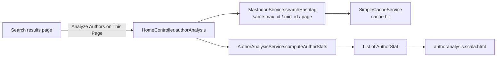

# Individual Feature: Author Analysis

> **@author** Kush Chaudhari

[Back to the main README](../README.md) and [group part](group.md)

---

## 1. Requirement

Delivery 1 individual task 4:

> Add a link at the top of the search to identify the authors who contributed the largest number of posts in a new page.

The feature must be reachable from the search results and work on the same page. It must rank authors by their number of posts.

## 2. User flow

1. The search page shows an **Analyze Authors on This Page** button. The button carries the current `hashtag`, `max_id`, `min_id` and `page`.
2. `GET /authoranalysis` checks the hashtag, asks `MastodonService` for that page, and passes the posts to `AuthorAnalysisServiceImpl`.
3. The page shows summary cards for posts analysed, active authors and the top share. It also shows a ranked author table.

## 3. Implementation

| Component | File | Responsibility |
| :--- | :--- | :--- |
| Controller action | [`HomeController.authorAnalysis`](../app/controllers/HomeController.java) | Validation, delegation, HTTP status and view selection |
| Service contract | [`AuthorAnalysisService`](../app/services/AuthorAnalysisService.java) | `computeAuthorStats(List<Post>)` |
| Service implementation | [`AuthorAnalysisServiceImpl`](../app/services/AuthorAnalysisServiceImpl.java) | Grouping, counting, language counts and sorting |
| Result model | [`AuthorStat`](../app/models/AuthorStat.java) | Read-only row with the author, post count, latest post and language counts |
| View | [`authoranalysis.scala.html`](../app/views/authoranalysis.scala.html) | Summary cards, ranking table, empty/error states |
| Route | [`conf/routes`](../conf/routes) | `GET /authoranalysis` |

### Algorithm

1. Return an empty list for a null or empty post list.
2. Go through the page's posts. Skip null posts and posts without an author account.
3. Build a grouping key for each author:
   - `id:<account-id>` when the account id is present.
   - Otherwise use `username:<lowercased-username>`.
   - Otherwise use `url:<profile-url>`.
   - Otherwise skip the author.
4. For each author, count the posts, add each language to a language count map, and keep the first (newest) post it finds.
5. Sort by post count from high to low. If two counts are equal, sort by display name and then by username, ignoring case.
6. Return a read-only list of `AuthorStat`.

### Example

For a page containing three posts by Alice (English and French) and two posts by Bob (English):

| Rank | Author | Posts | Share | Languages |
| :--- | :--- | :--- | :--- | :--- |
| 1 | Alice | 3 | 60.0% | EN x2, FR x1 |
| 2 | Bob | 2 | 40.0% | EN x2 |

## 4. Caching and error handling

- The action calls `searchHashtag` with the page's original ids. The search page has already cached that key, so the author analysis page usually answers from the cache. It does not make a new Mastodon request.
- An invalid hashtag returns `400 Bad Request` with a message. A Mastodon failure returns `500 Internal Server Error` with the service message. An empty page shows the "No author data available" state.

## 5. UI ownership

- **Author-analysis page, service and table: Kush Chaudhari.**
- Shared page layout, Bootstrap, CSS and pagination: **Qiang Xue**.
- Post and attachment card components used elsewhere in the application: **Owen Van Esbroeck**.

## 6. Tests and coverage

- [`AuthorAnalysisServiceImplTest`](../test/services/AuthorAnalysisServiceImplTest.java) covers counting, grouping by id (including distinct IDs sharing a username), case-insensitive username fallback and URL fallback, language counts, latest-post selection for newest-first input, null posts and authors, count/display-name/username sorting, immutable results, and empty input.
- [`HomeControllerTest`](../test/controllers/HomeControllerTest.java) covers the success page, the empty-results state, the error page, invalid hashtags, pagination parameter preservation and nonpositive page normalization, and escaping author-provided HTML.
- `sbt jacoco` reports 100% coverage for lines, branches, methods, complexity and classes.
