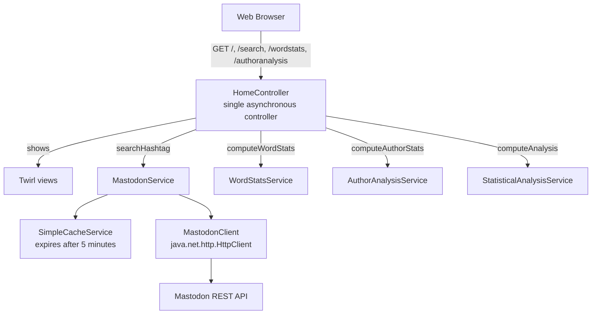

# Group Part: MAWA (Mastodon Analysis Web App)

> **@author** Kush Chaudhari, Mihir Vipulbhai Panchal, Owen Van Esbroeck, Qiang Xue

[Back to the main README](../README.md)

---

## 1. Scope

The group component is the Play Framework application. It lets a user search a Mastodon hashtag and retrieves one result page from the official Mastodon REST API. It shows the posts in a readable form, supports page navigation, and hosts the four individual features.

The implementation follows the Delivery 1 constraints:

- Play Framework 3.0.11 with Java.
- One asynchronous controller that returns `CompletionStage<Result>`.
- No blocking `.get()` or `.join()` in production code.
- No WebSockets, Pekko actors or reactive streaming.
- No Mastodon wrapper library. The REST client uses `java.net.http.HttpClient`.
- One Mastodon API call per hashtag page, with a five-minute cache shared by the analysis pages.

## 2. Team and contribution map

| Team member | Individual feature | Group / UI contribution |
| :--- | :--- | :--- |
| **Kush Chaudhari** | Author Analysis | Author-analysis controller action, service, model and page |
| **Mihir Vipulbhai Panchal** | Sentiment Analysis | Sentiment classifier, sentiment badge on each result card |
| **Owen Van Esbroeck** | Statistical Analysis | Statistical summary, chart panels, post cards and attachment display |
| **Qiang Xue** | Word Statistics | Word statistics service and page, basic HTML layout, Bootstrap integration, pagination controls, shared stylesheet, Mastodon client and cache code |

## 3. Request flow



The full component diagram, domain model and Delivery 2 notes are in [README section 8](../README.md#8-architecture--design-document).

## 4. Hashtag search

- The home page (`/`) shows a GET form. The user enters a hashtag with or without a leading `#`.
- `HomeController.cleanHashtag` trims the input, removes one leading `#`, and accepts only `[\p{L}\p{Nd}_]+` (Unicode letters, digits and underscore). Invalid input such as `c#`, `hello world` or `java/lang` returns `400 Bad Request` before any network call.
- `MastodonService.searchHashtag` checks the cache first, then calls `GET /api/v1/timelines/tag/{hashtag}` through `MastodonClientImpl`.
- The request uses the configured `mastodon.pageSize` as the API `limit`. The checked-in default is 40, the code fallback is 5, and the value is capped at 40.
- The token is sent as `Authorization: Bearer <token>` only when it is configured.
- The hashtag and pagination ids are encoded for the URL, so `#` or non-ASCII characters cannot break the query string.

## 5. Post display

Each result card shows the fields required by Delivery 1:

| Field | Source |
| :--- | :--- |
| Author | `Account.displayName`, `@username`, avatar |
| Publication date/time | `Post.createdAt` |
| Language | `Post.language`, displayed uppercase |
| Post content | `Post.content`: HTML cleaned to readable text by `HtmlCleaner` |
| Original link | `Post.url` |
| Visibility | `Post.visibility` |
| Extra information | reply/reblog/favourite counts, sentiment badge, attachments and link preview card |

The raw HTML is kept in `Post.rawContent` but is never shown in a page. `Post.content` is the cleaned text used by the views and by every analysis service.

### UI ownership

- **Basic HTML layout, Bootstrap 5 CDN, navigation, footer, pagination and base CSS: Qiang Xue.**
- **Post cards, avatars, image/video attachments and link preview cards: Owen Van Esbroeck.**
- **Sentiment badge: Mihir Vipulbhai Panchal.**
- **Statistical chart panels: Owen Van Esbroeck.**
- **Author-analysis entry point/page: Kush Chaudhari.**
- **Word-statistics links/page: Qiang Xue.**

## 6. Pagination

Pagination uses Mastodon pagination ids, not offsets:

- **Next (older)** uses `max_id`, the id of the last post on the current page.
- **Previous (newer)** uses `min_id`, the id of the first post on the current page.
- `Next` appears only when the page came back full (`posts.size() >= pageSize`).
- `Previous` appears only when the user is past page 1.

Every page has a GET URL that can be saved as a bookmark. The word statistics and author analysis pages reuse the same `max_id` / `min_id` / `page` values, so they usually answer from the same cache entry.

## 7. Error handling

| Situation | Response |
| :--- | :--- |
| Empty/invalid hashtag | `400 Bad Request` with a human-readable form message |
| Mastodon non-200 response | `500 Internal Server Error` with the service message |
| Network/timeout failure | `500 Internal Server Error`, never a stack trace |
| Empty result page | `200 OK` with an explicit "No posts found" state |
| Unknown page values | Treated as page 1 |

The controller never sends a raw exception to the browser. `MastodonServiceImpl` converts failures into `SearchResult` error objects.

## 8. Caching

`SimpleCacheService` uses a `ConcurrentHashMap` that is safe to use from multiple threads. Each entry expires after five minutes. The key is:

```text
tag:<lowercased-hashtag>:max_id:<id|latest>:min_id:<id|latest>:page:<n>
```

The search page stores the result with the page ids it used. Word statistics and author analysis pass the same ids, so opening either analysis for a page already viewed does not make a second Mastodon request.

## 9. Build, tests and documentation

- Build: `sbt compile`, `sbt run`.
- Tests: JUnit 4 + Mockito, with no live Mastodon traffic.
- Coverage: `sbt jacoco` reports 109 tests and 100% coverage for lines, branches, methods, complexity and classes.
- Javadoc: `sbt javadoc` runs over `app/` and `test/`, including private members. Every class and method has an `@author` tag.
- The JaCoCo report is generated at `target/scala-2.13/jacoco/report/html/index.html`.

## 10. Individual feature documents

- [Sentiment Analysis](sentiment-analysis.md): Mihir Vipulbhai Panchal
- [Sentiment Analysis Presentation Guide](sentiment-presentation-guide.md): simple overview and presentation script
- [Statistical Analysis](statistical-analysis.md): Owen Van Esbroeck
- [Author Analysis](author-analysis.md): Kush Chaudhari
- [Word Statistics](word-stats.md): Qiang Xue

## 11. Assumptions and limitations

- Delivery 1 uses plain HTTP requests and responses. It does not use reactive programming.
- The pages use Mastodon pagination ids. If a post is deleted between requests, the page contents can shift a little.
- The API returns at most 40 posts per request, so larger page sizes are capped.
- Public instances limit unauthenticated traffic. We recommend setting an access token for frequent searches and demos.
