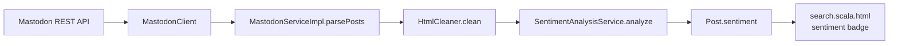

# Individual Feature: Sentiment Analysis

> **@author** Mihir Vipulbhai Panchal (ID: 40366948)

[Back to the main README](../README.md) and [group part](group.md)

---

## 1. Requirement

Delivery 1 individual task 2:

> Perform sentiment analysis on the retrieved posts. Determine if their descriptions are overall happy `:-)`, sad `:-(` or neutral `:-|`. This sentiment is displayed on the main search page for each search query. Process the `content` field, finding happy and sad words, emojis and emoticons and counting them. If a post contains more than 70% "happy" strings, return a happy sentiment, for more than 70% sad return sad, otherwise neutral. The content must be processed with the Java Streams API.

## 2. Where sentiment is produced

`MastodonServiceImpl.parsePosts` cleans each post's HTML and calls `SentimentAnalysisService.analyze(cleanContent)` before it creates the read-only `Post`. The result is stored in `Post.sentiment` and shown as a badge on every result card.

## 3. Implementation

| Component | File | Responsibility |
| :--- | :--- | :--- |
| Service contract | [`SentimentAnalysisService`](../app/services/SentimentAnalysisService.java) | `String analyze(String content)` |
| Service implementation | [`SentimentAnalysisServiceImpl`](../app/services/SentimentAnalysisServiceImpl.java) | Splits text into words, counts words and symbols, handles negation and applies the 70% rule |
| Integration | [`MastodonServiceImpl.parsePosts`](../app/services/MastodonServiceImpl.java) | Assigns sentiment while parsing each post |
| Model field | [`Post.getSentiment`](../app/models/Post.java) | Read-only sentiment symbol |
| View | [`search.scala.html`](../app/views/search.scala.html) | Badge showing `:-)`, `:-(` or `:-|` |

## 4. Classification algorithm

1. Null or blank content returns neutral `:-|`.
2. Clean the text:
   - Remove URLs and `@mentions`, so they do not add words.
   - Lower-case the text with `Locale.ROOT`.
   - Convert curly apostrophes to straight apostrophes.
3. Split the text into words and clause punctuation with a Unicode-aware pattern.
4. Count **happy** and **sad** matches:
   - English and Portuguese happy and sad word lists.
   - Happy and sad emoticons and emojis.
   - A negation within the three words before a match changes its direction. Clause punctuation, another sentiment word or a clause boundary stops the search.
5. If there are fewer than two matches, return neutral.
6. If happy matches are **more than 70%** of all matches, return `:-)`.
7. If sad matches are **more than 70%** of all matches, return `:-(`.
8. Otherwise return neutral `:-|`.

The 70% test uses whole numbers (`happyCount * 10 > totalCount * 7`) to avoid rounding problems at the boundary.

## 5. Java Streams usage

- `IntStream.range(0, words.length).filter(...).count()` checks each word position and applies negation without writing a loop.
- `symbols.stream().mapToLong(...).sum()` counts each emoticon and emoji in the lists.
- The complete implementation is in [`SentimentAnalysisServiceImpl.java`](../app/services/SentimentAnalysisServiceImpl.java).

## 6. UI ownership

- **Sentiment classifier and sentiment badge: Mihir Vipulbhai Panchal.**
- Shared HTML layout, Bootstrap, CSS and pagination: **Qiang Xue**.
- Post cards, avatars, attachment display and link preview cards: **Owen Van Esbroeck**.

## 7. Tests and coverage

- [`SentimentAnalysisServiceImplTest`](../test/services/SentimentAnalysisServiceImplTest.java) covers happy/sad words, emojis, emoticons, negation, mixed ratios, the exact 70% boundary, URL and mention removal, hashtags, and null/blank input.
- [`MastodonServiceImplTest`](../test/services/MastodonServiceImplTest.java) has a test that checks a real critical post is classified as sad.
- [`HomeControllerTest`](../test/controllers/HomeControllerTest.java) checks that the sentiment symbol is shown on the search page.
- `sbt jacoco` reports 100% coverage for lines, branches, methods, complexity and classes.
