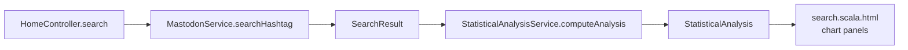

# Individual Feature: Statistical Analysis

> **@author** Owen Van Esbroeck

[Back to the main README](../README.md) and [group part](group.md)

---

## 1. Requirement

Delivery 1 individual task 3:

> Provide aggregate information about the retrieved posts at the top of the search. At minimum, display the total number of posts retrieved and the number of positive, negative and neutral posts. Java Streams must be used for at least part of the collection processing.

The implementation goes beyond the minimum. It also counts languages and visibility levels and calculates engagement values for replies, reblogs and favourites.

## 2. Where the analysis runs

`HomeController.search` computes the analysis from the same `SearchResult` that it shows, so the statistics always describe the posts on the current page.

## 3. Implementation

| Component | File | Responsibility |
| :--- | :--- | :--- |
| Service contract | [`StatisticalAnalysisService`](../app/services/StatisticalAnalysisService.java) | `computeAnalysis(List<Post>)` |
| Service implementation | [`StatisticalAnalysisServiceImpl`](../app/services/StatisticalAnalysisServiceImpl.java) | Counts and calculates values with Java Streams |
| Result model | [`StatisticalAnalysis`](../app/models/StatisticalAnalysis.java) | Read-only maps and JSON helper methods for the charts |
| Controller integration | [`HomeController.search`](../app/controllers/HomeController.java) | Computes and passes the analysis to the view |
| View | [`search.scala.html`](../app/views/search.scala.html) | Chart containers for sentiment, language, visibility and engagement |
| Frontend chart code | [`public/javascripts/chart.js`](../public/javascripts/chart.js) | Draws the four Chart.js panels |

## 4. Summary values

| Metric | How it is computed |
| :--- | :--- |
| Total posts | `posts.size()` |
| Sentiment counts | `groupingBy(Post::getSentiment, counting())` |
| Language counts | `groupingBy(Post::getLanguage, counting())` |
| Visibility counts | `groupingBy(Post::getVisibility, counting())` |
| Replies | sum, average, minimum and maximum of `getRepliesCount()` |
| Reblogs | sum, average, minimum and maximum of `getReblogsCount()` |
| Favourites | sum, average, minimum and maximum of `getFavouritesCount()` |

The `StatisticalAnalysis` class has helper methods that turn the maps into JSON:

- `getSentimentCountsAsJSON()` always includes the three standard symbols. A missing count becomes zero.
- `getLanguageCountsAsJSON()` changes common ISO codes to readable names, such as `en` to English. It keeps the raw code for other languages.
- `getVisibilityCountsAsJSON()` has one entry for each visibility level.
- `getEngagmentCountsAsJSON()` has the sum, average, minimum and maximum for each engagement metric.

## 5. Java Streams usage

- `posts.stream().collect(groupingBy(..., counting()))` builds the three count maps in one pass.
- `posts.stream().map(Post::getRepliesCount).map(Double::valueOf).toList()` collects the engagement values.
- `values.stream().reduce(...)` calculates the sum, minimum and maximum. The average is sum / size.
- The complete implementation is in [`StatisticalAnalysisServiceImpl.java`](../app/services/StatisticalAnalysisServiceImpl.java).

## 6. UI ownership

- **Statistical summary, `StatisticalAnalysis` model and the four chart panels: Owen Van Esbroeck.**
- Shared HTML layout, Bootstrap, CSS and pagination: **Qiang Xue**.
- Post cards, avatars, image/video attachments and link preview cards: **Owen Van Esbroeck**.

## 7. Tests and coverage

- [`StatisticalAnalysisServiceImplTest`](../test/services/StatisticalAnalysisServiceImplTest.java) checks all summary values for sentiment, language, visibility, replies, reblogs and favourites.
- [`StatisticalAnalysisTest`](../test/models/StatisticalAnalysisTest.java) covers the getters, sentiment keys and all JSON helper methods.
- [`HomeControllerTest`](../test/controllers/HomeControllerTest.java) tests the search page with the statistical analysis passed to the view.
- `sbt jacoco` reports 100% coverage for lines, branches, methods, complexity and classes.
