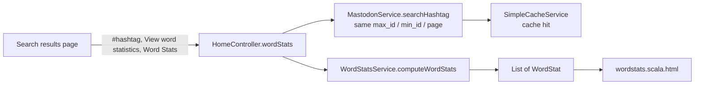

# Individual Feature: Word Statistics

> **@author** Qiang Xue

[Back to the main README](../README.md) and [group part](group.md)

---

## 1. Requirement

Delivery 1 individual task 5:

> For a search query, display word-level statistics for the retrieved posts, counting all unique words in descending order by frequency. The statistics page must be hyperlinked from the search terms above the results. The post content must be processed with the Java Streams API.

## 2. User flow



The links carry the current page ids (`max_id`, `min_id`, `page`), so the word statistics describe the posts the user is looking at. The search page has already cached that page, so the statistics page usually answers from the cache without another Mastodon call.

## 3. Implementation

| Component | File | Responsibility |
| :--- | :--- | :--- |
| Controller action | [`HomeController.wordStats`](../app/controllers/HomeController.java) | Validation, delegation, HTTP status and view selection |
| Service contract | [`WordStatsService`](../app/services/WordStatsService.java) | `computeWordStats(List<Post>)` |
| Service implementation | [`WordStatsServiceImpl`](../app/services/WordStatsServiceImpl.java) | Splits text into words, counts them and sorts them with Java Streams |
| Result model | [`WordStat`](../app/models/WordStat.java) | Read-only word and count pair |
| View | [`wordstats.scala.html`](../app/views/wordstats.scala.html) | Totals, frequency table, percentage bars and empty/error states |
| Route | [`conf/routes`](../conf/routes) | `GET /wordstats` |

## 4. Algorithm

1. Return an empty list for a null or empty post list.
2. Remove null posts and posts whose cleaned content is null or blank.
3. Take each post's `Post.content` and split it on `[^\p{L}\p{Nd}]+`. This keeps Unicode letters and digits and uses punctuation to separate words.
4. Lower-case each word and drop empty words.
5. Group by the word and count how many times it appears.
6. Sort by count from high to low. If two counts are equal, sort the words in alphabetical order.
7. Turn each entry into a `WordStat` and return the list.

The core pipeline is:

```java
posts.stream()
    .filter(post -> post != null && post.getContent() != null && !post.getContent().trim().isEmpty())
    .map(Post::getContent)
    .flatMap(content -> Arrays.stream(WORD_DELIMITER_PATTERN.split(content.toLowerCase())))
    .map(String::trim)
    .filter(word -> !word.isEmpty())
    .collect(Collectors.groupingBy(Function.identity(), Collectors.counting()))
    .entrySet()
    .stream()
    .sorted(Map.Entry.<String, Long>comparingByValue().reversed()
            .thenComparing(Map.Entry.comparingByKey()))
    .map(entry -> new WordStat(entry.getKey(), entry.getValue()))
    .collect(Collectors.toList());
```

## 5. Statistics page

- **Total words counted**: the sum of all word counts on the page.
- **Unique words**: the number of different words.
- **Frequency table**: rank, word, count badge and percentage bar.
- **Empty state**: a clear message when the page has no posts or no text.
- **Error state**: the Mastodon message is shown with a `500` response.

## 6. UI ownership

- **Word-statistics service, page, search links and statistics table: Qiang Xue.**
- **Basic HTML layout, Bootstrap 5 CDN, CSS and pagination: Qiang Xue.**
- Post cards, avatars, image/video attachments and link preview cards on the search page: **Owen Van Esbroeck**.

## 7. Tests and coverage

- [`WordStatsServiceImplTest`](../test/services/WordStatsServiceImplTest.java) covers null and empty input, blank and null content, punctuation and case, counting order, alphabetical order when counts are equal, Unicode letters and digits.
- [`WordStatTest`](../test/models/WordStatTest.java) covers construction, null handling, equality and `toString`.
- [`HomeControllerTest`](../test/controllers/HomeControllerTest.java) covers invalid input, success, reuse of page parameters and Mastodon errors.
- `sbt jacoco` reports 100% coverage for lines, branches, methods, complexity and classes.
